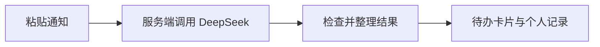

# 拾笺 · Note Inbox

把大学群里的长通知拆成清楚的待办卡片，边看要求边记进度。

[打开网页版](https://123.57.30.129/) · [GitHub 备用网页](https://kemou2333.github.io/note-inbox/) · [安卓下载](https://123.57.30.129/downloads/android-v2.28.2/campus-inbox-2.28.2.apk) · [GitHub备用下载](https://github.com/Kemou2333/campus-inbox/releases/latest)

大学群里的课程、报名和材料通知常常很长，看完容易忘，回头找截止时间和群号又得翻半天聊天记录。把通知粘贴进拾笺，服务端会调用 DeepSeek 理出简短说明、时间、适用人群和办理步骤。展开卡片就能打勾记进度、贴彩色便签写备注，底部留着整条原文方便核对，也能围绕通知提问或导出长图。

## 界面预览

*注：上方动图与截图均取自已发布产品的实际界面，内容为脱敏后的人工整理展示示例，不作为模型准确率证明。*

## 主要功能

* **理清通知重点**：提取通知中的简短说明、截止时间、适用人群、分步要求和注意事项。

* **边看边记进度**：在同一张卡片里勾选步骤、写彩色便签、收藏或搜索通知，少在聊天记录和待办软件之间来回切换。

* **核对、追问与同步**：保留完整原文供核对，支持围绕通知提问、本机导出长图，登录后可在网页与安卓端同步文字、笔记和进度（安卓另有本机提醒）。

## 实现概览

网页与安卓共用核心界面；用户粘贴通知后，服务端调用第三方 DeepSeek 转为结构化字段，经程序校验格式与边界后展示为待办卡片。

## 使用前须知

原文与提问会发给第三方 DeepSeek 处理，请勿输入身份证号、手机号等敏感信息。AI 可能漏读或理解有误，重要事项请核对原通知。工具不自动读群聊或代填表单；图片与附件通常留在本机。[隐私说明](docs/PRIVACY.md)。

[AGPL-3.0-only](LICENSE)
