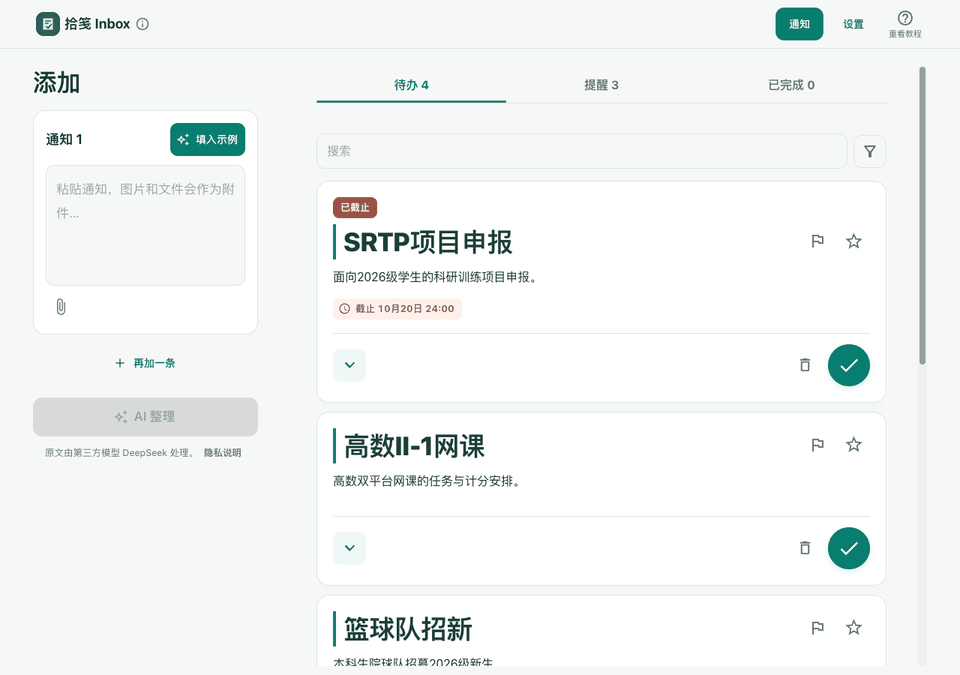
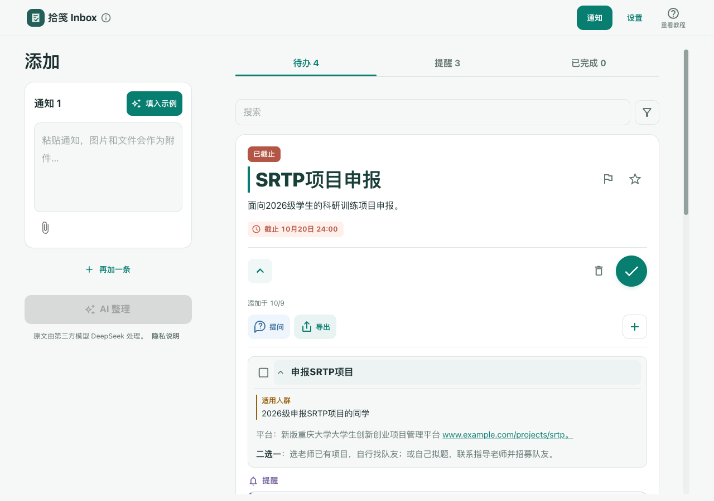
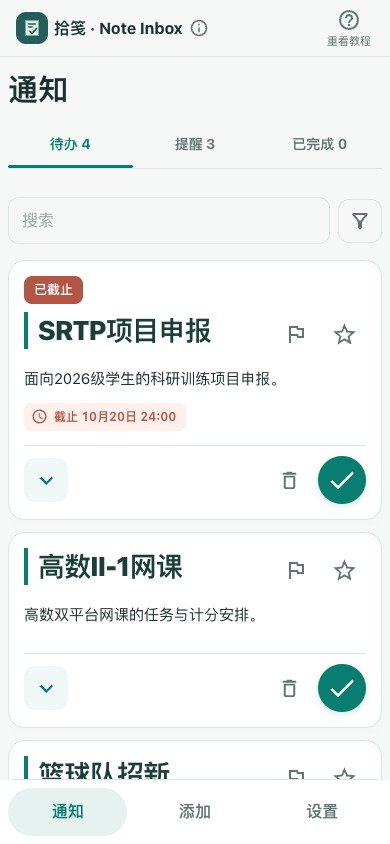
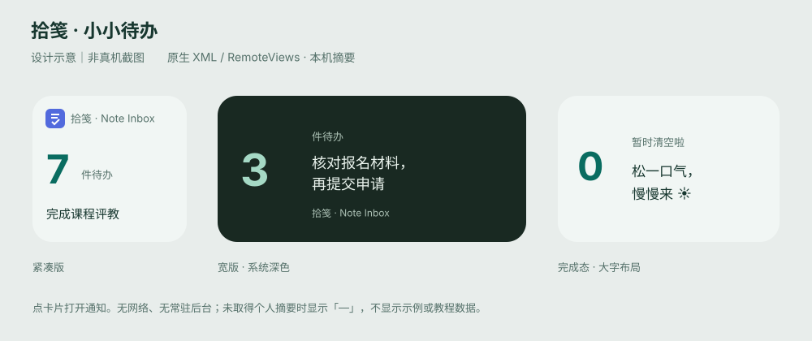

# 拾笺 Inbox

我刚上大一时，班群、学院群里的通知很多。一条通知往往很长，要做什么、什么时候截止，得来回翻着找。怕漏事，也不想每次都手抄一遍，于是做了这个小工具。

把通知粘进来，点「AI 整理」，就能看到简短说明、时间和待办步骤。办完打个勾，需要时还能提问、记笔记，或存成一张长图。

**[打开网页](https://123.57.30.129/)** · [GitHub Pages 备用网页](https://kemou2333.github.io/campus-inbox/) · [安卓下载](https://123.57.30.129/downloads/android-v2.28.0/campus-inbox-2.28.0.apk) · [GitHub 备用下载](https://github.com/Kemou2333/campus-inbox/releases/latest)

## 看一眼怎么用

演示使用已脱敏、人工整理的内置示例，不调用真实模型。

可以先显示示例，试一遍从阅读到完成的过程。支持多条通知一起整理、收藏、搜索、笔记和账号同步。安卓还可以把轻巧的待办小组件放到桌面。

小组件外观为设计示意，真实桌面启动器上的表现仍需手机验收。

## 使用前知道这几件事

**通知原文会发给第三方 DeepSeek 处理，请勿粘贴身份证号、手机号等敏感个人信息。** 提问也会发送问题和该通知原文。AI 可能漏信息，重要事项请核对原通知。

图片和附件文件本身留在本机；如果把文件中的文字放进输入框，这些文字仍会随原文发送。使用账号同步时，通知、笔记和进度会保存到服务器。详见[隐私说明](docs/PRIVACY.md)。

两个网页入口各自打开；登录或进入时接续，有修改时同步，也可手动同步。安卓安装包优先从阿里云下载，每次需要图形验证，GitHub 保留备用。旧版可直接安装最新版，无需逐级安装。

## 项目说明

[文档入口](docs/README.md) · [当前验证范围](docs/VALIDATION.md) · [历次验证归档](docs/archive/validation/README.md)

Kemou 制作 · 原名校园 Inbox · [AGPL-3.0](LICENSE)
